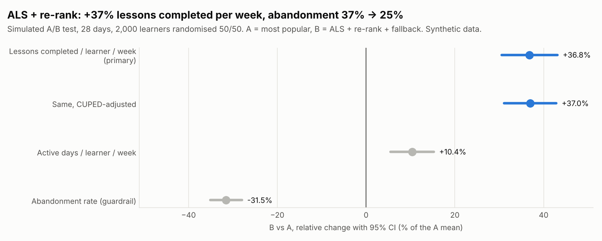
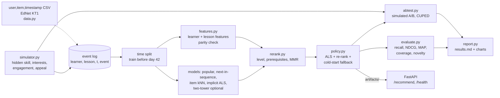
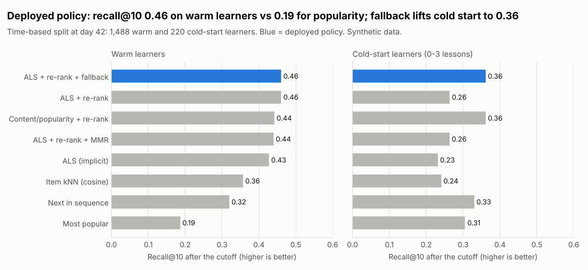

# Learning Content Recommender


This project answers one question for a language-learning app: **which lesson should each
learner see next, so they keep learning and keep coming back?** It trains implicit-feedback
matrix factorisation (ALS, written in NumPy) on lesson starts and completions, then re-ranks
the results with rules a teacher would use: not too far above the learner's level, and no
lesson before its prerequisites. It is evaluated offline with a time-based split (including
cold-start learners) and online in a simulated A/B test against a most-popular baseline, with
CUPED and a guardrail metric. All data is **synthetic**, from a documented learner simulator. A
loader for public implicit-feedback logs (generic user,item,timestamp CSV and EdNet KT1) is
included.

**What this project shows**

- Implicit ALS from the paper (Hu, Koren, Volinsky 2008): confidence weights, the `Y^T Y`
  trick, fold-in for new events, and tests that the loss never increases and that planted
  structure is recovered.
- Honest offline evaluation: a single time cutoff with a leakage test, completions as the
  label, four baselines, recall/NDCG/MAP plus coverage and novelty, and separate cold-start
  results with a content/popularity fallback.
- Learning-aware re-ranking: a level estimate from history, a prerequisite filter, MMR for
  variety, and a ground-truth "too hard" rate that only a simulator can measure.
- A simulated online A/B test: randomisation, primary and guardrail metrics, CUPED, delta-method
  CIs, a sample-ratio check, and a frank look at where offline and online results disagree.
- A small FastAPI service with one feature function for training and serving, and a parity
  check that blocks training if the two paths disagree.



## Problem

I ran an online language centre (HaiEduTech). Learners rarely quit because content is missing.
They quit after a few lessons that were too hard, or too boring, or about topics they do not
care about. A "most popular" shelf is easy to build, but popular lessons are often popular with
the wrong level. So two things matter at once:

1. **Relevance:** what will this learner want to open? (collaborative filtering)
2. **Learnability:** can they finish it, and will it move them forward? (level, prerequisites)

And the result has to be measured on what the business cares about: lessons completed and
learners coming back, not only offline recall.

## Architecture



Step-by-step code walkthrough and maths: **[docs/how-it-works.md](docs/how-it-works.md)**.
Why each choice was made: **[docs/decisions.md](docs/decisions.md)**.

## Quick start

```bash
python -m venv .venv && source .venv/bin/activate
make install          # pip install -e ".[dev]"
make check            # ruff, mypy, pytest with the coverage gate
recsys report         # whole study: docs/results.md + docs/img/*.png (about 20 seconds)
recsys train          # fit on synthetic data, save artifacts/
recsys serve          # API on http://127.0.0.1:8000/docs
```

```bash
curl 'localhost:8000/recommend?learner_id=L0042&k=3'
```

```json
{"learner_id": "L0042", "known_learner": true, "strategy": "ALS (implicit)", "est_level": 2.237,
 "features": {"n_started": 36.0, "n_completed": 22.0, "completion_rate": 0.605, "...": "..."},
 "items": [{"lesson_id": "pron_04", "topic": "pronunciation", "level": 1, "prereqs_met": true},
           {"lesson_id": "pron_01", "topic": "pronunciation", "level": 1, "prereqs_met": true},
           {"lesson_id": "trav_08", "topic": "travel", "level": 2, "prereqs_met": true}]}
```

An unknown `learner_id` is treated as a new learner and gets the cold-start fallback
(`"strategy": "fallback: Content + popularity fallback"`, level-1 lessons).

**Real data.** `recsys evaluate --data log.csv --format csv` (columns `user_id,item_id,timestamp`,
for example a MOOCCube user-video log exported to CSV) or `--format ednet` with a folder of
EdNet KT1 `u*.csv` files. Public logs have no lesson levels or prerequisites, so the
re-ranking rules have nothing to act on there; popularity, kNN and ALS are the meaningful rows.

## Results (synthetic data)

From `recsys report` ([docs/results.md](docs/results.md)): 2,000 simulated learners, 300
lessons, 56 days, 96,764 events. Models are fit on events before day 42 and scored on 1,708
learners who completed a new lesson after it (220 of them cold-start, at most 3 lessons before
the cutoff).

| Model | recall@10 (all) | NDCG@10 | coverage | too hard* | recall@10 (cold start) |
| --- | --- | --- | --- | --- | --- |
| Most popular | 0.202 | 0.138 | 0.107 | 0.004 | 0.305 |
| Next in sequence | 0.321 | 0.333 | 0.943 | 0.230 | 0.330 |
| Item kNN (cosine) | 0.342 | 0.274 | 0.743 | 0.147 | 0.241 |
| ALS (implicit) | 0.402 | 0.328 | 0.753 | 0.232 | 0.232 |
| ALS + re-rank | 0.435 | 0.358 | 0.577 | 0.016 | 0.263 |
| ALS + re-rank + MMR | 0.417 | 0.348 | 0.553 | 0.013 | 0.263 |
| **ALS + re-rank + fallback (deployed)** | **0.447** | **0.365** | 0.577 | 0.016 | **0.361** |

\* Share of recommended lessons more than one level above the learner's true skill (simulator
ground truth; an unmet prerequisite adds a level).



Simulated A/B test: 2,000 learners randomised 50/50 for 28 days, A = most popular,
B = deployed policy.

| Metric | A | B | B - A (95% CI) |
| --- | --- | --- | --- |
| Lessons completed per learner per week (primary) | 2.015 | 2.757 | +0.742 (+0.615 to +0.869) |
| Same, CUPED-adjusted | | | +0.745 (+0.626 to +0.864) |
| Abandonment rate (guardrail) | 36.6% | 25.0% | -11.5 pts (-12.8 to -10.2) |
| Active days per learner per week | 1.765 | 1.948 | +0.183 (+0.097 to +0.270) |
| True skill gain (simulator only) | 0.034 | 0.081 | +0.047 (+0.040 to +0.055) |

**How to read this honestly**

- The A/B lift (+36.8% completions per week) is large because the simulator was built with
  the effects the re-ranker uses: too-hard lessons get abandoned and abandonment lowers the
  chance of coming back. The test shows that the code finds and measures these effects. It
  does not predict the lift with real learners.
- Offline and online disagree in size: B has 2.2x the offline recall of popularity, but a
  +37% online lift. Learners also browse on their own, and a recommendation they would have
  found anyway adds nothing.
- Re-ranking adds only 0.033 offline recall over plain ALS, but cuts too-hard picks from
  23.2% to 1.6%. Logged data rewards "they finished it anyway"; it cannot see the cost of a
  too-hard lesson that was shown and dropped.
- Next in sequence has the best offline MAP@10 (0.258) while 23% of its picks are too hard.
  The logging policy often continued the same track, so the test window rewards copying it
  (exposure bias).
- MMR costs a little recall here (0.435 to 0.417) and lowers novelty; on this data it is not
  worth turning on by default.
- CUPED reduced the variance by only 10.9%: pre-period completions are a weak predictor
  because engagement changes over time.

## Design decisions (summary)

- **Simulator as ground truth**, with the planted effects written down (so the A/B result can
  be explained, and discounted).
- **Completions are the label**, one global time cutoff, and a test that rewrites the future
  and checks nothing changes.
- **ALS in NumPy with a direct solve per row**; fold-in for new events; hyperparameters picked
  on a separate tuning world.
- **Abandon is not a negative signal** for ALS; difficulty is the re-ranker's job.
- **Explicit re-ranking rules** (level, prerequisites with placement, optional MMR).
- **Cold-start fallback** at 3 lessons or fewer.
- **One feature function** for training and serving, with a parity gate in `recsys train`.
- **Two-tower is optional** (`.[deep]`), so CI stays fast.

Full reasoning and costs: [docs/decisions.md](docs/decisions.md).

## Project layout

```
src/recsys/
  simulator.py   the synthetic world: lessons, learners, choices, completion, engagement
  domain.py      Catalog, LearnerHistory, EventStore (shared by every part)
  data.py        loaders (canonical CSV, user,item,timestamp CSV, EdNet KT1), time split
  features.py    learner and lesson features, level estimate, parity check
  baselines.py   most popular, next in sequence, item kNN, content/popularity fallback
  als.py         implicit ALS (Hu et al. 2008) with fold-in
  two_tower.py   optional torch model (not run here)
  rerank.py      level penalties, prerequisite filter, MMR
  policy.py      deployed policy + JSON/NPZ save and load
  metrics.py     recall, NDCG, MAP, coverage, novelty
  evaluate.py    offline evaluation with warm / cold-start segments
  abtest.py      simulated A/B test, Welch, CUPED, delta method
  artifacts.py   recsys train: artefacts + parity gate
  api.py         FastAPI: /recommend, /health
  report.py      docs/results.md and the two charts
  cli.py         recsys generate | evaluate | train | report | serve
docs/            how-it-works, decisions, results, charts
tests/           42 test cases (+1 two-tower test skipped without torch), 98% coverage
```

## Testing and quality

- **42 test cases** (one more, for the two-tower model, runs when torch is installed): ALS loss
  never increasing, ALS recovering planted blocks, fold-in equal to the trained factor, metric
  functions on hand examples, the time split and a future-rewrite leakage test, held-out
  targets excluding already-started lessons, the re-ranker respecting prerequisites and
  placement, level penalties and MMR, the cold-start fallback and its beginner levels, the
  saved bundle giving identical recommendations, feature parity and hand-computed features,
  simulator determinism and planted effects, CUPED and the delta method on known data, the
  A/B pipeline, the API contract, the loaders on small inline samples, and the CLI and report.
- **CI** (GitHub Actions): ruff lint and format, mypy, pytest with an 80% coverage gate, Docker
  image build. `pre-commit install` runs the same checks locally.

## What I'd do next

- Run the offline evaluation on a public log (EdNet KT1 or a MOOCCube export) and report it
  next to the synthetic numbers.
- Learn the re-ranking weights from completion outcomes (for example a small logistic model
  on level gap, prerequisites and the ALS score) instead of hand-setting them.
- Off-policy evaluation (inverse propensity scoring) with logged slate probabilities, to
  estimate online effects before an A/B test.
- Retrain daily inside the A/B simulation and add a third arm (ALS without re-ranking) to
  separate the effect of the model from the effect of the rules.
- Run the two-tower model with the `[deep]` extra and compare with ALS on the same split.

Data: synthetic, generated by `recsys.simulator`. The loaders support user,item,timestamp CSV
exports (for example from [MOOCCube](http://moocdata.cn/data/MOOCCube)) and
[EdNet KT1](https://github.com/riiid/ednet); check their licences and terms of use before
downloading. Licence of this code: MIT.
